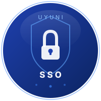

# SSOUyuni

<p align="center">
  
</p>

**SSOUyuni** is a production-ready OIDC authentication proxy for [Uyuni](https://www.uyuni-project.org/) (SUSE patch management).  
It enables users to log in to Uyuni using their **Microsoft Entra ID (Azure AD)** credentials, with automatic account provisioning and role synchronization.

---

## How it works

```
Browser → nginx (TLS 443)
           → gunicorn :5002 (Flask)
              ├─ OIDC flow  → login.microsoftonline.com
              ├─ Secrets    → Azure Key Vault (Managed Identity)
              ├─ Provision  → Uyuni XML-RPC
              └─ Proxy      → Uyuni HTTPS (HTTP + WebSocket)
```

1. User visits `https://uyuni-proxy.internal` → redirected to Microsoft login
2. After authentication, Uyuni account is created or updated via XML-RPC
3. Flask opens a Uyuni session using an ephemeral password, stores cookies server-side
4. All subsequent requests are proxied transparently — the browser never sees internal Uyuni URLs or cookies

## Features

- **Multi-tenant**: each organization authenticates against its own Entra tenant
- **Zero standing secrets in .env**: all credentials in Azure Key Vault
- **Role sync**: Entra App Roles map to Uyuni roles on every login
- **Ephemeral passwords**: single-use, generated fresh at every login
- **WebSocket proxy**: full Uyuni UI functionality
- **Rate limiting**: per-IP auth failure tracking (no Redis required)
- **Audit log**: optional Azure Table Storage, always in journald

## Requirements

| Component | Version |
|-----------|---------|
| Ubuntu | 22.04 LTS or 24.04 LTS |
| Python | 3.10+ |
| nginx | any stable |
| Azure VM | System-assigned Managed Identity |
| Azure Key Vault | Standard tier |
| Uyuni | any supported version with XML-RPC API |

**Recommended VM size**: `Standard_B2s` (2 vCPU, 4 GB RAM)  
**Outbound network**: 443 to `login.microsoftonline.com`, Key Vault endpoint, Uyuni server

## Quick install

```bash
git clone https://github.com/<your-org>/SSOUyuni.git
cd SSOUyuni
sudo bash setup.sh
```

Then follow the post-install checklist printed by setup.sh.

See **[docs/installation.md](docs/installation.md)** for the complete step-by-step guide.

## Documentation

| Document | Description |
|----------|-------------|
| [docs/architecture.md](docs/architecture.md) | System design, flows, security decisions |
| [docs/installation.md](docs/installation.md) | Full installation guide (Azure + Uyuni + VM) |
| [docs/add-organization.md](docs/add-organization.md) | Adding a new organization |
| [docs/operations.md](docs/operations.md) | Logging, maintenance, secret rotation, monitoring |

## Running tests

```bash
python3 -m venv .venv && source .venv/bin/activate
pip install -r requirements.txt pytest
pytest tests/ -v
```

## Version

Current: **1.0.0** — see [CHANGELOG.md](CHANGELOG.md)

## License

Internal tool — not for public distribution.
