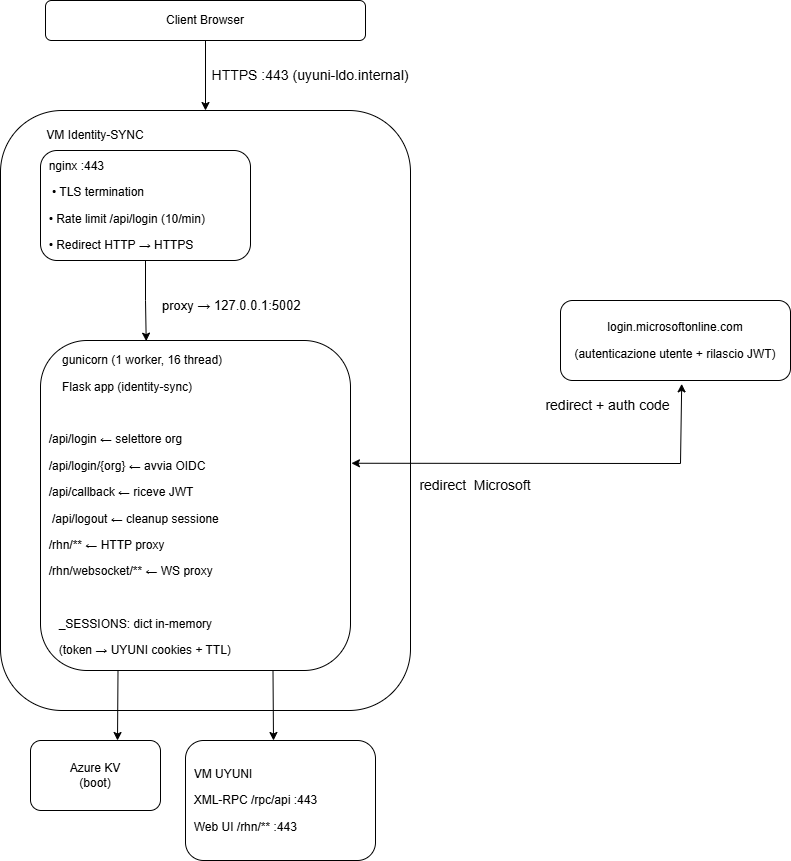
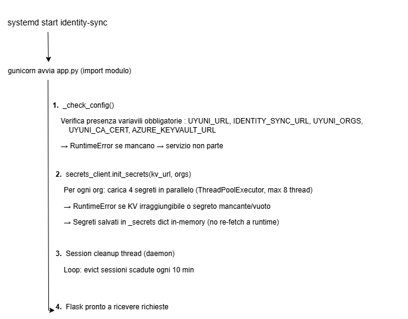
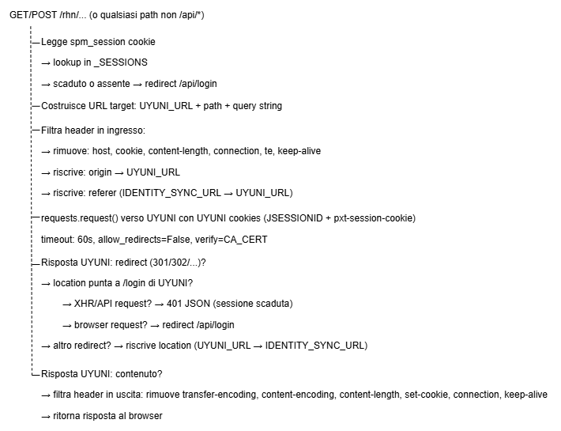
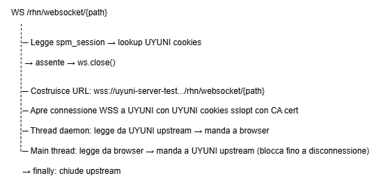
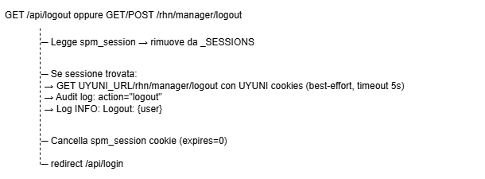
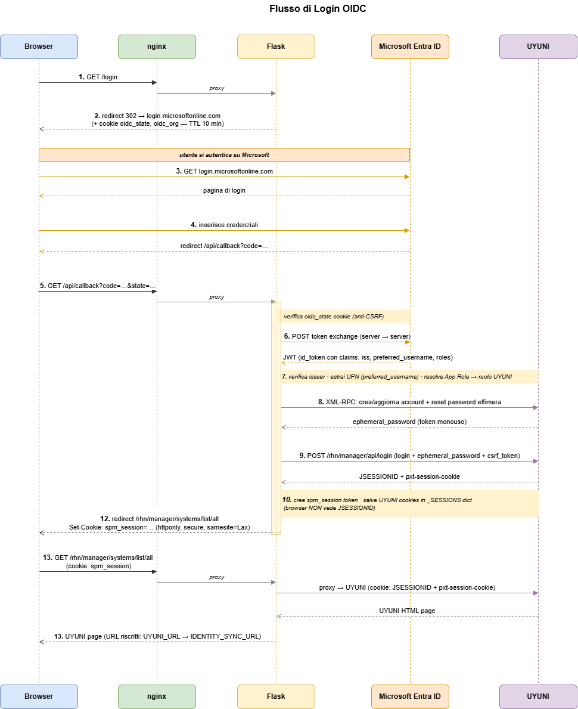

# SSOUyuni — Architecture

This document describes the structure, data flows, and architectural decisions of SSOUyuni.
Intended for maintenance or extension of the service.

## 1. File structure

```
SSOUyuni/
├── app.py                    ← Flask entry point: routing, proxy, session store
├── oidc_client.py            ← OIDC with Microsoft: auth URL, token exchange, roles
├── secrets_client.py         ← Azure Key Vault secrets cache (loaded at boot)
├── uyuni_user_provisioner.py ← Uyuni account provisioning via XML-RPC
├── uyuni_web_client.py       ← Uyuni web login: CSRF token + session cookies
├── requirements.txt          ← Python dependencies
├── .env.example              ← Template for the .env file
│
├── tests/                    ← Test suite
│   ├── conftest.py           ← Shared fixtures
│   ├── test_app.py           ← Flask route tests, proxy, session, rate limiting
│   ├── test_oidc_client.py   ← OIDCClient, extract_identity, resolve_role tests
│   ├── test_secrets_client.py ← init_secrets, get_sync_password, get_entra_config tests
│   └── test_uyuni_user_provisioner.py ← ensure_user, _sync_role, _parse_name tests
│
├── deploy/
│   ├── nginx.conf            ← nginx configuration (TLS, rate limit, proxy)
│   └── ssouuni.service       ← systemd unit file
└── setup.sh                  ← Installation script
```

**External dependencies**:

| Library | Purpose |
|---------|---------|
| `flask` | Web framework and routing |
| `flask-sock` | WebSocket support (bridge to Uyuni) |
| `gunicorn` | WSGI server in production |
| `msal` | Microsoft Authentication Library (OIDC/OAuth2) |
| `requests` | HTTP proxy to Uyuni |
| `websocket-client` | WebSocket connection to Uyuni |
| `azure-identity` | DefaultAzureCredential for Managed Identity |
| `azure-keyvault-secrets` | Reading secrets from Key Vault |
| `azure-data-tables` | Audit log on Azure Table Storage (optional) |

## 2. General architecture



**Session model**: the browser never sees Uyuni cookies (`JSESSIONID`, `pxt-session-cookie`).
It receives only `spm_session` (an opaque token), which Flask uses to retrieve the Uyuni cookies
from the in-process `_SESSIONS` dict. This is why gunicorn must run with `--workers 1`.

## 3. Boot flow



**Critical implication**: after rotating a Key Vault secret, the service must be restarted.
Secrets are not reloaded at runtime.

## 4. Login flow (OIDC)

.png)

**Ephemeral password**: generated fresh at every login, used once to open the Uyuni web
session, then discarded. Microsoft is the sole authentication source.

## 5. HTTP proxy flow



**URL rewriting**: Flask replaces `UYUNI_URL` with `IDENTITY_SYNC_URL` in HTML bodies
and in redirects. The browser never sees the internal Uyuni IP — it always sees the proxy hostname.

## 6. WebSocket flow



## 7. Logout flow



## 8. Detailed file descriptions

### `app.py` — Flask entry point

**Primary responsibility**: routing, session store, HTTP and WebSocket proxy, audit log.

**Key sections**:

- **Boot** (`_boot`, lines 83–91): verifies config and loads Key Vault secrets at import time.
  If it fails, the process does not start — no silent retry.
- **Session store** (`_SESSIONS`, lines 110–127): thread-safe in-memory dict with lock.
  Structure: `{token → {cookies, expires, user}}`. Not persistent: sessions do not
  survive a service restart.
- **Auth rate limiting** (`_AUTH_FAILURES`, lines 130–173): per-IP tracking of authentication
  failures. 60s window, threshold 15 attempts. Only auth/authz failures — not infrastructure
  errors. No dependency on Redis or external libraries.
- **Route `/api/login`** (lines 295–318): org selector. With a single org, redirects directly,
  bypassing the selector.
- **Route `/api/login/{org}`** (lines 331–354): starts OIDC. Generates state, sets two
  `httponly`+`samesite=Lax` cookies scoped to `/api/callback` (TTL 10 min).
- **Route `/api/callback`** (lines 357–453): login core. 8 sequential steps, each with
  fail-fast and logging.
- **`_do_proxy`** (lines 497–553): HTTP proxy to Uyuni. Handles redirects with expired
  session detection, HTML body URL rewriting, header filtering.
- **`ws_proxy`** (lines 558–601): bidirectional WebSocket bridge.
  Daemon thread for the upstream→browser leg.
- **Security headers** (`_SECURITY_HEADERS`, lines 99–104): restrictive CSP applied
  only to auth pages (`/api/login`, `/api/callback`). Not applied to proxy responses —
  avoids overriding Uyuni's own CSP.

### `oidc_client.py` — OIDC with Microsoft Entra

**Primary responsibility**: build auth URL, token exchange, issuer verification, identity and role extraction.

**Key sections**:

- **`OIDCClient`** (lines 46–101): OIDC client bound to a single Entra tenant.
  Thread-safe (MSAL is thread-safe). Cached per org via `@functools.lru_cache`.
  - `get_auth_url()`: `prompt="login"` always forces credential entry
    (important on shared PCs).
  - `exchange_code()`: server-to-Microsoft exchange. The `code` is never forwarded
    to the browser — this is the critical OIDC security point.
  - `verify_issuer()`: compares `claims.iss` with the expected issuer for the tenant.
    Mandatory in multi-tenant to prevent cross-tenant substitution attacks.
- **`get_client(org)`** (line 104): factory with LRU cache. On first access reads
  config from `secrets_client` and creates `OIDCClient`. Cache is indefinite (while
  the process lives) — does not reload secrets at runtime.
- **`extract_identity()`** (lines 111–137): extracts `(local_part, domain)` from the JWT.
  Priority: `preferred_username` > `email` > `upn`. Skips `preferred_username` if
  it contains `#EXT#` (B2B guest format — the domain would be the host tenant, not
  the original user).
- **`resolve_role()`** (lines 140–170): maps Entra App Role to Uyuni role.
  Returns `(authorized: bool, role: str|None)`. Unknown roles logged at DEBUG.

### `secrets_client.py` — Key Vault secrets cache

**Primary responsibility**: load Key Vault secrets at boot, thread-safe access at runtime.

**Key sections**:

- **`init_secrets(kv_url, orgs)`** (lines 22–74): loads all secrets in parallel
  (ThreadPoolExecutor). Fail-fast: if even one secret is missing or empty,
  raises RuntimeError with detail of which secrets are missing. Called once at boot.
- **`_secrets`** (line 18): global dict `{secret_name → value}`. Populated only
  by `init_secrets`. Read-only access at runtime — no lock needed after boot.
- **KV naming convention**: 2 global secrets (shared across all orgs) + 2 per-org secrets.
  The global secrets (`entra-client-id`, `entra-client-secret`) correspond to the shared
  multi-tenant App Registration. The per-org secrets (`entra-{org}-tenant-id`,
  `uyuni-sync-{org}`) vary per organization.
- **`get_sync_password(org)`** / **`get_entra_config(org)`** (lines 77–95):
  accessors that wrap KeyError in explicit messages.
- **`_init_for_testing()`** / **`_reset()`** (lines 103–114): test-only API.
  Injects secrets without a real Key Vault.

### `uyuni_user_provisioner.py` — XML-RPC provisioning

**Primary responsibility**: create and update individual Uyuni accounts. Synchronize roles.

**Key sections**:

- **`_TimeoutTransport`** (lines 32–42): `xmlrpc.client` has no native timeout.
  This class adds it by overriding `make_connection`. Timeout 15s (aligned
  with `_XMLRPC_TIMEOUT`).
- **`_make_ssl_context()`** (lines 45–53): SSL context with Uyuni CA cert. Cached with
  `@functools.lru_cache`. SSL bypass is not permitted in production.
- **`ensure_user()`** (lines 81–135): main logic.
  - Generates `ephemeral_pw = secrets.token_urlsafe(24)` (single-use password).
  - XML-RPC login as `{org}-account-sync`.
  - `user.getDetails()`: distinguishes "user not found" (fault -213) from other errors.
  - If not found: `user.create()` with email as login, first/last name from `_parse_name()`.
  - If found: `user.setDetails()` with new ephemeral password.
  - `_sync_role()` after create/update.
  - `auth.logout()` in finally (guaranteed).
- **`_parse_name()`** (lines 64–78): `mario.rossi@domain` → `("Mario", "Rossi")`.
  Only the first two segments separated by `.` or `_`. Non-alnum character sanitization.
  `last_name` cannot be empty in Uyuni — fallback to `first_name`.
- **`_sync_role()`** (lines 138–168): acts only on `_MANAGEABLE_ROLES`
  (`org_admin`, `system_group_admin`). Never touches `satellite_admin` or other roles.
  Add/remove are independent (one can fail without blocking the other).

### `uyuni_web_client.py` — Uyuni web login

**Primary responsibility**: obtain Uyuni session cookies via web login (CSRF-aware).

**Key sections**:

- **`get_session_cookies()`** (lines 27–83): 3-step flow.
  - Step 1: GET `/rhn/manager/login` → extracts `csrf_token` with `_CSRF_RE` regex.
    Uyuni rejects POST without a valid CSRF token.
  - Step 2: POST `/rhn/manager/api/login` with `{login, password, csrf_token}` in the JSON
    body + `X-CSRF-Token` in the header.
  - Step 3: verifies `data.success == True`. Verifies presence of `JSESSIONID` and
    `pxt-session-cookie` in the response.
- **`verify`** parameter: path to the CA cert (passed from `app.py` as `_CA_CERT`).
  Not read from env here — the sole source is `app.py`.

## 9. Key security decisions

| Decision | Rationale |
|----------|-----------|
| `prompt="login"` in OIDC | Forces credentials on every access. Important on shared PCs where Microsoft might reuse an existing browser session. |
| `verify_issuer()` mandatory | In multi-tenant, a valid token from tenant A must not be accepted for tenant B. Prevents cross-tenant substitution attacks. |
| Ephemeral Uyuni password | Microsoft is the sole source of truth. A stolen fixed password could allow direct Uyuni access bypassing Entra. The ephemeral password is valid only while the Uyuni web session is active. |
| Server-side session store | The browser never sees Uyuni's `JSESSIONID` or `pxt-session-cookie`. Even if `spm_session` were stolen, it does not expose direct Uyuni credentials. |
| `samesite=Lax` (not Strict) | Required for the OIDC callback. Microsoft redirects the browser to `/api/callback` from a different domain — with `Strict` the `oidc_state` and `oidc_org` cookies would not be sent on this cross-site redirect. `Lax` allows them for top-level navigation redirects. |
| `compare_digest` for state | Constant-time comparison — eliminates timing side-channel for the anti-CSRF state. |
| Per-IP auth failures | Internal rate limiting with no external dependencies. Counts only auth/authz failures, not infrastructure errors. Avoids lockout from legitimate bursts (e.g. network flap). |
| CSP only on auth pages | The `default-src 'none'` CSP applied to Uyuni proxy responses would break the Uyuni Web UI. Flask applies the CSP only to its own HTML pages. |
| SSL bypass disabled | `SSL: CERTIFICATE_VERIFY_FAILED` is an explicit error, not a silent one. Forces correct CA cert configuration before deploy. |
| `--workers 1` gunicorn | `_SESSIONS` is an in-process dict. With multiple workers, each process has its own `_SESSIONS` and sessions are lost ~50% of the time (round-robin). |

## 10. Known limitations and constraints

| Limitation | Detail |
|------------|--------|
| Non-persistent session store | Sessions are lost on every service restart. Users must re-authenticate. For persistence: migrate `_SESSIONS` to Redis. |
| Key Vault secrets not hot-reloaded | After rotating a secret, `systemctl restart ssouuni` is required. No hot-reload. With the shared multi-tenant App Registration, rotation covers a single `entra-client-secret` for all orgs. |
| Single-worker mandatory | `gunicorn --workers 1`. Multi-worker would require Redis or sticky sessions. |
| `system_group_admin` requires manual assignment | Users with the `UyuniOperator` role (→ `system_group_admin`) see zero systems until manually assigned to groups in Uyuni. Not automated. |
| Audit log optional | Without `AUDIT_TABLE_CONNECTION`, access events are logged only to `journalctl`. No long-term persistence of access events. |
| No SAML | Only OIDC. Uyuni itself is not configured for SAML — it is completely unaware of Azure AD. |

## Appendix — Schemas

### Schema A — Physical architecture

Components (nodes):
- `Client Browser` (Corporate PC)
- `nginx :443` (Proxy VM)
- `gunicorn :5002` (Proxy VM, loopback)
- `Azure Key Vault` (Azure)
- `login.microsoftonline.com` (Microsoft, Internet)
- `Uyuni Server :443` (Uyuni VM)

Connections:
- Client → nginx: HTTPS:443, label "uyuni-proxy.internal"
- nginx → gunicorn: HTTP:5002, label "proxy 127.0.0.1"
- gunicorn → Azure Key Vault: HTTPS:443, label "Managed Identity / boot"
- gunicorn → Uyuni Server: HTTPS:443, label "XML-RPC + web login"
- gunicorn → login.microsoftonline.com: HTTP redirect via browser, label "OIDC redirect"
- Client → login.microsoftonline.com: HTTPS:443, label "user authentication"
- login.microsoftonline.com → Client → nginx: HTTPS, label "callback with code"

### Schema B — Login flow



1. The HTTPS request arrives at nginx, which acts as a reverse proxy. nginx handles no authentication logic and has no knowledge of Microsoft Entra ID: it receives the HTTPS connection, terminates TLS, and forwards the request to the Flask application listening on localhost:5002. Flask responds by identifying the user's organization. If multiple organizations are configured, it presents an HTML selector for choosing the correct tenant.

2. Flask does not authenticate the user directly and neither knows nor manages user credentials. It only knows that, for the organization, there is a Microsoft tenant with a configured App Registration. It generates a random `state` value (32 characters) used as an anti-tampering and CSRF protection mechanism in the OIDC flow. The value is saved in a cookie (`oidc_state`) scoped to `/api/callback` with a 10-minute TTL. It also saves the selected organization (`oidc_org`). Flask then returns a redirect to `login.microsoftonline.com`, including in the URL: the `client_id`, the callback URI (`/api/callback`), and the `state` parameter.

3. The user is authenticated directly by Microsoft. The browser is redirected to the Microsoft Entra ID portal, entering a domain completely outside SSOUyuni's control. The user enters their corporate credentials, completes any MFA, and satisfies configured access policies. All of this happens exclusively between the user's browser and Microsoft servers. Microsoft verifies the credentials and checks that the user is assigned to the `uyuni-entra-sync` application within the correct tenant and has at least one valid App Role (`UyuniAdmin`, `UyuniOperator`, or `UyuniReadOnly`). If validation succeeds, Microsoft generates a one-time `authorization code` valid for a few minutes and redirects the browser to: `https://uyuni-proxy.internal/api/callback?code=...&state=...`

4. The browser returns to Flask via nginx. Flask immediately performs the first security check: it compares the `state` parameter received in the URL with the value previously saved in the `oidc_state` cookie. The two values must match exactly and the comparison is done in constant time to mitigate timing attacks. Any alteration of the redirect or fraudulent callback attempt would produce a state mismatch, immediately halting the authentication process.

5. Flask proceeds to exchange the `authorization code` with Microsoft via a server-to-server call completely invisible to the browser. This is the central point of the OpenID Connect protocol. The `code` received in the URL is unusable without the `client_secret` associated with the application. Flask sends a direct request to Microsoft providing: the authorization code, the `client_id`, and the `client_secret`. The browser does not participate in this phase and has no access to the `client_secret` or the resulting token. Microsoft validates the `client_secret`, permanently invalidates the one-time `code`, and returns a cryptographically signed JWT containing the user's identity and authorizations.

6. Flask analyzes the JWT and performs a series of security checks. The first concerns the `issuer`: the token must come exactly from the Microsoft tenant associated with the organization. This check prevents multi-tenant attacks where a user from a different tenant might try to present a formally valid token issued for another organization. Any token not signed by the expected tenant is immediately rejected.

7. Flask then extracts the user's identity from the `preferred_username` claim, which contains the full UPN. This value will be used as the local username in Uyuni. Flask reads the `roles` claim, which contains the App Roles assigned in Entra ID, and maps them to Uyuni roles:
    - `UyuniAdmin` → `org_admin`
    - `UyuniOperator` → `system_group_admin`
    - `UyuniReadOnly` → read-only access without additional privileges
    If the user has no valid role, Flask halts the process with an authorization error.

8. Flask creates or updates the user's local account in Uyuni. Uyuni has no native integration with Microsoft Entra ID and requires a local account for each authenticated user. Flask connects to Uyuni via XML-RPC using the `{org}-account-sync` service account, configured as an Organization Administrator during installation. The credentials are stored in Key Vault. Flask checks whether the user already exists:
    - if absent: creates the new account;
    - if present: updates the existing profile.
    In both cases it generates a random 24-character ephemeral password and sets it on the user's account. It then synchronizes application roles: adds any missing privileges and removes privileges no longer present in the JWT. The ephemeral password remains valid only for the few seconds needed to open the web session.

9. Flask starts an authenticated Uyuni session on behalf of the user. Because Uyuni implements CSRF protection on web login, Flask must follow the full application flow:
    - performs a GET to the login page to extract the `csrf_token`;
    - sends a POST containing the username, ephemeral password, and `csrf_token`, inserted in both the body and the headers.
    Uyuni authenticates the user and returns session cookies, typically `JSESSIONID` and `pxt-session-cookie`. The ephemeral password has served its purpose and will not be reused.

10. Flask implements its own session management model. The Uyuni session cookies are never exposed to the user's browser. Flask stores them server-side only, in an in-memory structure associated with a random identifier (`spm_session`). The browser receives only this opaque token. Consequently:
    - the client does not know `JSESSIONID`;
    - it has no direct access to Uyuni;
    - it does not know the internal server IP address;
    - it is unaware of the existence of a separate backend.

11. Flask concludes the login by returning a redirect to `/rhn/manager/systems/list/all` together with the `spm_session` cookie, configured with security attributes:
    - `HttpOnly` → not accessible via JavaScript;
    - `Secure` → transmitted only over HTTPS;
    - `SameSite=Lax` → CSRF mitigation.

12. From this point, Flask operates as a transparent application proxy. Every browser request to Uyuni passes through Flask. When the browser requests, for example, `/rhn/manager/systems/list/all`, Flask:
    - reads the `spm_session` cookie;
    - retrieves the associated Uyuni cookies from server-side memory;
    - forwards the request to the Uyuni server using the authenticated session;
    - receives the HTML response;
    - replaces any internal host references with the public proxy hostname;
    - returns the response to the browser.
    From the end user's perspective, the interaction happens entirely via the proxy hostname. The user sees only the Uyuni interface, with no direct exposure of Flask, the real session cookies, or the underlying internal infrastructure.
