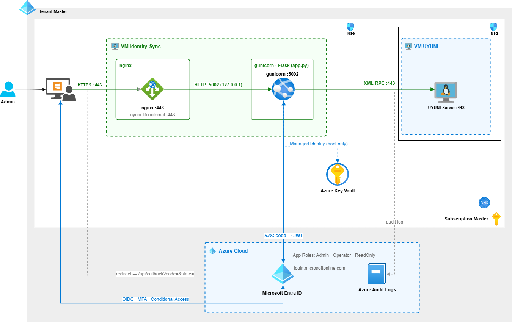
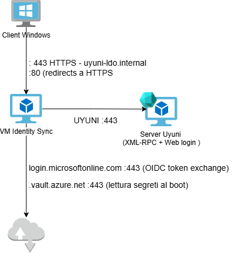
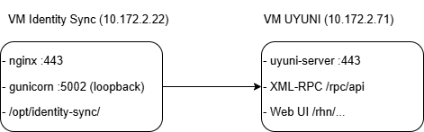

# SSOUyuni — Installation Guide

This guide covers installing and configuring SSOUyuni.
When complete, users will be able to access Uyuni via Microsoft Entra ID (Azure AD) authentication,
with automatic individual account provisioning and role synchronization.



## 1. Infrastructure requirements

### 1.1 Software prerequisites on the proxy VM

| Component | Minimum version | Notes |
|-----------|----------------|-------|
| Ubuntu | 22.04 LTS | 24.04 LTS also supported |
| Python | 3.10 | `python3 --version` |
| pip | included in Python 3.10 | |
| nginx | any stable | `apt-get install nginx` |
| Azure CLI (`az`) | ≥ 2.50 | only for initial Key Vault secret population |

### 1.2 Required network flows



| Source | Destination | Port | Protocol | Purpose |
|--------|------------|------|----------|---------|
| Client | Proxy VM | 443 | HTTPS | User access |
| Client | Proxy VM | 80 | HTTP | Redirect to HTTPS |
| Proxy VM | Uyuni VM | 443 | HTTPS | XML-RPC + web login |
| Proxy VM | login.microsoftonline.com | 443 | HTTPS | OIDC token exchange |
| Proxy VM | `<kv>.vault.azure.net` | 443 | HTTPS | Key Vault secret reading |
| Admin | Proxy VM | 22 | SSH | Deploy and configuration (via Bastion) |

> Configure NSG rules and/or VM firewall for all flows above.
> The Uyuni VM does not need direct internet access — only from the proxy VM.

### 1.3 Required Azure permissions

| Resource | Permission | Who needs it | Purpose |
|----------|-----------|-------------|---------|
| Entra ID (each org tenant) | Application Administrator | Operator configuring phase 1 | Create App Registration, assign roles |
| Key Vault | Key Vault Secrets Officer | Azure account running deploy | Write secrets to KV |
| Key Vault | Key Vault Secrets User | VM Managed Identity | Read secrets at runtime |
| Azure VM | Contributor (or Owner) | Infrastructure admin | Enable Managed Identity |
| Subscription | Reader | Optional | Browse resources |

### 1.4 Uyuni prerequisites

- Administrative access to Uyuni (account with **Uyuni Administrator** or **Organization Administrator** role for each org) to create service accounts.
- The Uyuni server must be reachable from the proxy VM via HTTPS.
- The Uyuni CA certificate must be accessible (extracted from the Uyuni container).

## 2. VM topology

SSOUyuni can run on a **separate VM** or on the **same VM** as Uyuni.

### 2a — Separate VM (example configuration)



In `.env`:
```
UYUNI_URL=https://uyuni-server.internal
```
On the proxy VM `/etc/hosts`:
```
<uyuni-ip>  uyuni-server.internal
```

### 2b — Same VM as Uyuni

```
Uyuni + SSOUyuni VM
┌─────────────────────────────────────────┐
│  nginx :443                             │
│  gunicorn :5002 (loopback)              │
│  uyuni-server :8080 or :443 (internal)  │
│  /opt/ssouuni/                          │
└─────────────────────────────────────────┘
```

In `.env`:
```
UYUNI_URL=https://uyuni-server.internal
```
In `/etc/hosts` on the VM:
```
127.0.0.1  uyuni-server.internal
```

> **nginx port**: if Uyuni already uses port 443, nginx for SSOUyuni must use a different port
> (e.g. 8443) or consolidate into a single nginx with different `server_name` values.

> **SSL cert**: the proxy cert and the Uyuni cert must not collide.
> Maintain two separate certs, each with their own SAN.

## PHASE 1 — Configure Azure Entra ID

### 1.1 Create the App Registration

**Portal**: `portal.azure.com` → Entra ID → **App registrations** → **New registration**

| Field | Value |
|-------|-------|
| Name | `uyuni-entra-sync` |
| Supported account types | **Accounts in any organizational directory (Multitenant)** |
| Redirect URI | Web → `https://uyuni-proxy.internal/api/callback` |

> If the portal shows "Allow all tenants" or similar, select it.

Click **Register**.

**Immediately after**, go to **Overview** and note:
- `Application (client) ID` → will be the global KV secret `entra-client-id`
- `Directory (tenant) ID` → is the hub tenant's tenant ID (not used for external orgs)

### 1.2 Create the 3 App Roles

**Where**: App Registration → **App roles** → **Create app role**

Create these three roles one at a time:

| Display name | Value | Allowed member types | Description |
|-------------|-------|---------------------|-------------|
| `UyuniAdmin` | `UyuniAdmin` | Users/Groups | Uyuni Organization Administrator |
| `UyuniOperator` | `UyuniOperator` | Users/Groups | Uyuni System Group Administrator |
| `UyuniReadOnly` | `UyuniReadOnly` | Users/Groups | Uyuni Read Only Access |

For each role: check **Enable this app role** → **Apply**.

> **The Value field is case-sensitive.** `UyuniAdmin` ≠ `uyuniAdmin`.
> The code in `oidc_client.py` checks these exact names in the JWT `roles` claim.

### 1.3 Enable "Assignment required"

**Where**: Entra ID → **Enterprise applications** → `uyuni-entra-sync` → **Properties**

| Field | Value |
|-------|-------|
| Assignment required | **Yes** |

Click **Save**.

> Without this, any user in the tenant can start the OIDC flow.
> With Assignment required = Yes, only users with explicit assignment can access.

### 1.4 Assign roles to users

**Where**: Enterprise applications → `uyuni-entra-sync` → **Users and groups** → **Add user/group**

For each authorized user:
1. Click **Add user/group**
2. Select the user
3. Select the role (`UyuniAdmin`, `UyuniOperator`, or `UyuniReadOnly`)
4. Click **Assign**

> A user without an assigned App Role will receive "User not authorized" at login.

### 1.5 Enable the `email` claim in the token

**Where**: App Registration → **Token configuration** → **Add optional claim**

- Token type: **ID**
- Claim: **`email`**
- Click **Add**
- If the popup "Turn on the Microsoft Graph email permission" appears: click **Add**

### 1.6 Create the Client Secret

**Where**: App Registration → **Certificates & secrets** → **New client secret**

| Field | Value |
|-------|-------|
| Description | `ssouuni` |
| Expires | **24 months** |

Click **Add**.

> **CRITICAL**: copy the value from the **Value** column immediately (not "Secret ID").
> The value appears only once. If you navigate away without copying it, you must create a new one.

### 1.7 Summary of values to record

This App Registration is **shared across all organizations** (multi-tenant).
The `client_id` and `client_secret` values go into **global** KV secrets (set once).
Each external org's `tenant_id` is recorded separately per org (per-org KV secret).

**Global secrets** (inserted once, valid for all orgs):

| Value | Where to find it | KV secret |
|-------|-----------------|-----------|
| Client ID | Overview → Application (client) ID | `entra-client-id` |
| Client Secret Value | Copied at step 1.6 | `entra-client-secret` |

**Per-org secret** (repeated for each organization added):

| Value | Where to find it | KV secret |
|-------|-----------------|-----------|
| Org Tenant ID | Overview of the org's tenant → Directory (tenant) ID | `entra-{org}-tenant-id` |

> The `tenant_id` to record for each org is the one from the **external organization's tenant**,
> not the hub tenant where the App Registration resides.

**Final verification**: App Registration → **Authentication** → verify that only
`https://uyuni-proxy.internal/api/callback` is present. Remove any unnecessary URI.

## PHASE 2 — Create service accounts in Uyuni

Create a service account for each organization. This account (`{org}-account-sync`)
is used by SSOUyuni to create and update individual user accounts via XML-RPC.

> **Requirement**: access to Uyuni with **Uyuni Administrator** or **Organization Administrator**
> role for each org. This is the only step requiring manual access to the Uyuni Web UI.

**Where**: Uyuni Web UI → **Admin** → **Users** → **Create User**

For each organization:

| Field | Value |
|-------|-------|
| Login | `{org}-account-sync` |
| Password | generate a secure password (≥ 20 characters) |
| Role | **Organization Administrator** |
| Organization | select the correct organization |

> **Record the password** — it must be inserted in Key Vault as `uyuni-sync-{org}` (PHASE 3).
> This account must be used only by the Flask app via XML-RPC.

## PHASE 3 — Configure Azure Key Vault

Secrets (Entra credentials + account-sync passwords) live in Azure Key Vault.
The proxy VM accesses them via Managed Identity.

### 3.1 Create the Key Vault

**Portal** → **Key Vaults** → **Create**

| Field | Value |
|-------|-------|
| Resource group | VM resource group |
| Name | `uyuni-identity-kv` (globally unique name) |
| Region | same region as the VM |
| Pricing tier | Standard |
| Access configuration | **Azure role-based access control** |

> If corporate policy blocks the public endpoint (`RequestDisallowedByPolicy`),
> in the **Networking** tab select **Disable public access** and create a Private Endpoint
> after creation (see step 3.2).

Click **Review + create** → **Create**.

### 3.2 Private Endpoint (if public endpoint disabled by policy)

**KV → Networking → Private endpoint connections → + Create**

| Tab | Field | Value |
|-----|-------|-------|
| Resource | Target sub-resource | `vault` |
| Virtual Network | Virtual network | Proxy VM VNet |
| Virtual Network | Subnet | Proxy VM Subnet |
| DNS | Integrate with private DNS zone | Yes (if available) |

After creation, if not using private DNS, add the hostname to the VM:

```bash
# Find the private IP: Portal → Private endpoints → <pe-name> → Network interface
# Then on the VM /etc/hosts:
10.172.x.x  uyuni-identity-kv.vault.azure.net

# Verify connectivity
curl -s https://uyuni-identity-kv.vault.azure.net/healthstatus
# Expected output: {"ApplicationHealthState":"Healthy"}
```

### 3.3 Enable Managed Identity on the VM

**Portal → Virtual Machines → [Proxy VM] → Identity → System assigned → Status: On → Save**

Note the `Object (principal) ID` generated — needed for KV role assignment.

### 3.4 Assign roles on the Key Vault

**KV → Access control (IAM) → Add role assignment** — two separate assignments:

| Role | Assigned to | How to find |
|------|-------------|-------------|
| **Key Vault Secrets User** | VM Managed Identity | Search by Object ID from step 3.3 |
| **Key Vault Secrets Officer** | Your Azure account | Your email account |

For each assignment: **Add role assignment** → select role → **Members** → search entity → **Review + assign**.

### 3.5 Populate secrets in Key Vault

From the VM via Bastion (has access to KV via Private Endpoint):

```bash
az login --use-device-code
KV="uyuni-identity-kv"

# ── Global secrets (run ONCE, valid for all orgs) ─────────────────────────
# Values copied at steps 1.6 and 1.7 of the shared App Registration

az keyvault secret set --vault-name $KV --name "entra-client-id" --value "<application-client-id>"
az keyvault secret set --vault-name $KV --name "entra-client-secret" --value "<client-secret-value-from-1.6>"

# ── Per-org secrets (repeat for each organization) ────────────────────────
# (replace {org} with the organization name in lowercase)

az keyvault secret set --vault-name $KV --name "entra-{org}-tenant-id" --value "<tenant-id-of-{org}-tenant>"
az keyvault secret set --vault-name $KV --name "uyuni-sync-{org}" --value "<password-{org}-account-sync>"
```

**KV naming convention**:

Global secrets (2, inserted once):

| KV secret name | Contents |
|----------------|---------|
| `entra-client-id` | Application (client) ID of the shared multi-tenant App Registration |
| `entra-client-secret` | App Registration client secret (Value column, not Secret ID) |

Per-org secrets (2 per org, `{org}` always lowercase):

| KV secret name | Contents |
|----------------|---------|
| `entra-{org}-tenant-id` | Directory (tenant) ID of the org's external Entra tenant |
| `uyuni-sync-{org}` | Password of the `{org}-account-sync` account in Uyuni |

**Secret verification** (from the VM, after configuring Managed Identity):

```shell
az keyvault secret list --vault-name uyuni-identity-kv
```

```bash
az keyvault secret show --vault-name uyuni-identity-kv --name "uyuni-sync-{org}" --query value -o tsv
```

### 3.6 Admin consent in the organization's tenant

With the multi-tenant App Registration, each organization (external tenant) must grant
admin consent before its users can authenticate.

**For each new org**, the organization's tenant administrator must open in a browser
(substituting the real values):

```
https://login.microsoftonline.com/{tenant-id-org}/adminconsent?client_id={entra-client-id}&redirect_uri=https://uyuni-proxy.internal/api/callback
```

Where:
- `{tenant-id-org}` is the Directory (tenant) ID of the external organization's tenant
- `{entra-client-id}` is the value of the KV secret `entra-client-id`

The administrator will see a Microsoft consent screen → click **Accept**.

> If the admin does not have permission to grant tenant-level consent, they can open
> a consent request that a Global Administrator must approve from the Azure portal
> (`portal.azure.com` → Entra ID → Enterprise applications → `uyuni-entra-sync` → Permissions
> → Grant admin consent for {tenant}).

**After consent**, still in the organization's tenant, the admin must:

1. Go to `portal.azure.com` → **Entra ID** → **Enterprise applications** → `uyuni-entra-sync`
2. **Properties** → **Assignment required**: set to **Yes** → **Save**
3. **Users and groups** → **Add user/group**: assign authorized users with the appropriate role
   (`UyuniAdmin`, `UyuniOperator`, or `UyuniReadOnly`)

> Without `Assignment required = Yes`, any user in the tenant can start the OIDC flow.
> Without an explicit role assignment, the user will receive "User not authorized" at login.

## PHASE 4 — Deploy on the VM

All commands below run on the **proxy VM** (via Bastion).

### 4.1 Create the service directory

```bash
sudo mkdir -p /opt/ssouuni
```

### 4.2 Copy the application files

Copy using `setup.sh` (see README) or `git clone` directly to `/opt/ssouuni/`:

```bash
# Option A: git clone
git clone https://github.com/<your-org>/SSOUyuni.git /opt/ssouuni
cd /opt/ssouuni
sudo bash setup.sh

# Option B: manual copy
# After setup.sh runs, files are in /opt/ssouuni/
```

### 4.3 Create the Python virtual environment

```bash
sudo python3 -m venv /opt/ssouuni/venv
sudo /opt/ssouuni/venv/bin/pip install --upgrade pip
sudo /opt/ssouuni/venv/bin/pip install -r /opt/ssouuni/requirements.txt
```

Installed packages: `flask`, `flask-sock`, `gunicorn`, `msal`, `requests`,
`websocket-client`, `azure-identity`, `azure-keyvault-secrets`, `azure-data-tables`.

### 4.4 Create the dedicated service user

```bash
sudo useradd -r -s /sbin/nologin -d /opt/ssouuni ssouuni
sudo chown -R ssouuni: /opt/ssouuni
```

> The process does not run as `root`. The `ssouuni` user cannot do interactive login.

### 4.5 Extract and configure the Uyuni CA certificate

The service connects to Uyuni over HTTPS. The Uyuni cert is self-signed — SSL bypass is disabled.
The CA cert is in the Uyuni container.

**On the Uyuni primary node** (connect via Bastion):

```bash
# Find the active Uyuni container name
podman ps

# Export the CA certificate (use the container name found above)
podman exec uyuni-server cat /srv/www/htdocs/pub/RHN-ORG-TRUSTED-SSL-CERT
```

Copy the full output (from `-----BEGIN CERTIFICATE-----` to `-----END CERTIFICATE-----`).

**On the proxy VM**:

```bash
sudo mkdir -p /opt/ssouuni/ssl

sudo cat > /opt/ssouuni/ssl/uyuni-ca.crt << 'EOF'
← paste output from the podman exec command
EOF

sudo chmod 640 /opt/ssouuni/ssl/uyuni-ca.crt
sudo chown ssouuni: /opt/ssouuni/ssl/uyuni-ca.crt
```

### 4.6 Configure `/etc/hosts`

```bash
# Separate VM from Uyuni: add to /etc/hosts
<uyuni-ip>  uyuni-server.internal

# Same VM as Uyuni:
# echo "127.0.0.1  uyuni-server.internal" | sudo tee -a /etc/hosts

# For local service testing:
127.0.0.1    uyuni-proxy.internal
```

### 4.7 Generate the TLS certificate for nginx

```bash
sudo openssl req -x509 -newkey rsa:4096 -sha256 -days 3650 -nodes \
    -keyout /opt/ssouuni/ssl/key.pem \
    -out    /opt/ssouuni/ssl/cert.pem \
    -subj   "/CN=uyuni-proxy.internal" \
    -addext "subjectAltName=IP:<YOUR_VM_IP>,DNS:uyuni-proxy.internal"

sudo chown ssouuni: /opt/ssouuni/ssl/*.pem
sudo chmod 640 /opt/ssouuni/ssl/*.pem
```

> Adjust `IP:<YOUR_VM_IP>` to the proxy VM's actual IP.
> After regeneration, redistribute the cert to Windows clients (see section 11).

## PHASE 5 — Configure nginx

nginx handles TLS, exposes port 443, and applies rate limiting on `/api/login`.

```bash
sudo apt-get install -y nginx

sudo cp /opt/ssouuni/deploy/nginx.conf /etc/nginx/sites-available/ssouuni

sudo ln -s /etc/nginx/sites-available/ssouuni \
           /etc/nginx/sites-enabled/ssouuni

# Remove default site to avoid port conflicts
sudo rm -f /etc/nginx/sites-enabled/default

sudo nginx -t && sudo systemctl restart nginx
sudo systemctl enable nginx
```

**Verify nginx**:

```bash
# Should respond HTTP 302 toward login.microsoftonline.com
curl -Ik https://uyuni-proxy.internal/api/login
```

## PHASE 6 — Configure the systemd service

```bash
sudo cp /opt/ssouuni/deploy/ssouuni.service /etc/systemd/system/ssouuni.service

sudo systemctl daemon-reload
sudo systemctl enable ssouuni
# DO NOT start yet — complete PHASE 7 (.env) first
```

The service file configures:
- `--workers 1 --threads 16`: required for the in-memory session store (shared `_SESSIONS` dict)
- `Restart=on-failure`: automatic restart on crash
- systemd hardening: `NoNewPrivileges`, `PrivateTmp`, `ProtectSystem=strict`

## PHASE 7 — Create the `.env` file

The `.env` contains URL and configuration. Secrets are in Key Vault.

```bash
sudo nano /opt/ssouuni/.env
```

Content (see also `.env.example` in the repository):

```bash
# ── Azure Key Vault ───────────────────────────────────────────────────────────
AZURE_KEYVAULT_URL=https://uyuni-identity-kv.vault.azure.net/

# ── Organizations ─────────────────────────────────────────────────────────────
# Exact org names in lowercase, comma-separated
UYUNI_ORGS={org1},{org2}

# ── URLs ──────────────────────────────────────────────────────────────────────
UYUNI_URL=https://uyuni-server.internal
IDENTITY_SYNC_URL=https://uyuni-proxy.internal

# ── SSL ───────────────────────────────────────────────────────────────────────
UYUNI_CA_CERT=/opt/ssouuni/ssl/uyuni-ca.crt

# ── Optional ──────────────────────────────────────────────────────────────────
# SESSION_TTL_HOURS=12
# LOG_LEVEL=INFO
# AUDIT_TABLE_CONNECTION=<storage-account-connection-string>
```

Protect the file:

```bash
sudo chmod 600 /opt/ssouuni/.env
sudo chown ssouuni: /opt/ssouuni/.env
```

## PHASE 8 — Start and verify

### 8.1 Start the service

```bash
sudo systemctl start ssouuni
sudo systemctl status ssouuni
```

Status must be `active (running)`. If it shows `failed`:

```bash
journalctl -u ssouuni -n 50
```

Common startup errors and solutions:

| Error message | Cause | Solution |
|--------------|-------|----------|
| `Missing required env vars: AZURE_KEYVAULT_URL` | `.env` missing or var absent | Check PHASE 7 |
| `UYUNI_CA_CERT must be set` | CA cert not configured | Redo PHASE 4.5 |
| `UYUNI_ORGS must contain at least one organization` | `UYUNI_ORGS` empty in `.env` | Add at least one org |
| `Key Vault secrets missing or empty: uyuni-sync-{org}` | KV secret missing or empty | Check PHASE 3.5 |
| `ForbiddenByRbac` | Managed Identity lacks KV permissions | Check PHASE 3.4 |
| `KV unreachable` | Private Endpoint or `/etc/hosts` missing | Check PHASE 3.2 |

### 8.2 Verify health check

```bash
curl -sk https://uyuni-proxy.internal/api/health
# Expected output: {"status": "ok"}

curl -Ik https://uyuni-proxy.internal/api/login
# Expected: HTTP/1.1 302 ... Location: https://uyuni-proxy.internal/api/login (selector)
#   or 302 to login.microsoftonline.com if only one org
```

### 8.3 Full browser access test

1. On the client (with `/etc/hosts` entry and cert imported), open: `https://uyuni-proxy.internal/api/login`
2. Select the organization (if multi-org)
3. Microsoft login appears → sign in with an account that has an App Role assigned
4. After authentication: browser arrives at `https://uyuni-proxy.internal/rhn/manager/systems/list/all`
5. Verify: Uyuni is open in the correct org
6. Verify: the role in Uyuni matches the App Role assigned in Entra
7. Verify logout: click Logout in Uyuni → redirect to `https://uyuni-proxy.internal/api/login`

### 8.4 Multi-org test

Repeat test 8.3 for each org configured in `UYUNI_ORGS`. A user from org A who
selects org B will see a Microsoft error (account not in tenant B) — expected behavior.

## 11. Certificate distribution to Windows clients

The TLS certificate is self-signed. Each client PC must import it as a trusted root.

**On the VM**: export the cert for distribution:

```bash
cat /opt/ssouuni/ssl/cert.pem
```

Copy the output, save as `uyuni-proxy.crt` on the Windows PC, then:

1. Double-click `uyuni-proxy.crt`
2. **Install Certificate** → **Local Machine**
3. Store: **Trusted Root Certification Authorities**
4. Confirm

Add the entry to `C:\Windows\System32\drivers\etc\hosts` (as administrator):

```
<proxy-vm-ip>    uyuni-proxy.internal
```

## 12. Client Secret rotation (every 24 months)

The client secret expires after 24 months. With the shared multi-tenant App Registration,
there is **one** client secret to rotate — the rotation applies to all organizations.

**1. Create the new secret** (without deleting the old one):

Portal → App Registration → `uyuni-entra-sync` → Certificates & secrets → New client secret
- Description: `ssouuni-YYYY-MM`
- Expires: 24 months
- Copy the **Value** immediately

**2. Update the global secret in Key Vault** (from the VM via Bastion):

```bash
az keyvault secret set \
  --vault-name "uyuni-identity-kv" \
  --name "entra-client-secret" \
  --value "<new-value>"
```

**3. Restart the service** (Key Vault secrets are loaded into memory at boot):

```bash
sudo systemctl restart ssouuni
sudo systemctl status ssouuni
```

**4. Verify login from the browser** → then delete the old secret from the Azure portal.

> **Reminder**: set a calendar reminder for 23 months after secret creation.

## 13. Access monitoring

```bash
# Live stream
journalctl -u ssouuni -f

# Today's accesses
journalctl -u ssouuni --since "today" --no-pager -g "Login:|Logout:|Access denied:"

# Last 100 events
journalctl -u ssouuni --no-pager -n 100

# New account provisioning only
journalctl -u ssouuni -g "UYUNI user created"
```

Event format:
```
INFO app: Login: 'user@tenant.onmicrosoft.com' (org={org}, role=org_admin)
INFO app: Logout: 'user@tenant.onmicrosoft.com'
INFO app: Access denied: 'user@external.com' (org={org})
INFO uyuni_user_provisioner: UYUNI user created: 'user@tenant.onmicrosoft.com' in org '{org}'
INFO uyuni_user_provisioner: Role 'org_admin' added to 'user@tenant.onmicrosoft.com'
INFO uyuni_web_client: UYUNI web login OK: 'user@tenant.onmicrosoft.com'
```

## 14. Adding a new organization

See [add-organization.md](add-organization.md).

## 15. Troubleshooting

| Symptom | Likely cause | Solution |
|---------|-------------|---------|
| `HTTP 302` does not go to Microsoft | `IDENTITY_SYNC_URL` wrong in `.env` | Fix and restart |
| "Invalid session" after Microsoft login | `oidc_state` cookie not received | Check `SameSite=Lax` on nginx |
| "User not authorized" | No App Role assigned in Entra | Enterprise Application → Users and groups |
| "User not authorized" (role assigned) | `roles` claim absent in token | App roles → verify Enable ✓ → reassign user |
| "Organization not configured" | Domain not in `UYUNI_ORGS` | Add org to `.env` + Uyuni account + KV secrets |
| Uyuni provisioning error | `{org}-account-sync` missing or wrong password | Check PHASE 2 + KV secret `uyuni-sync-{org}` |
| `SSL: CERTIFICATE_VERIFY_FAILED` | `UYUNI_URL` uses IP or CA cert missing | Use hostname + check PHASE 4.5 |
| Service fails to start: "UYUNI_CA_CERT must be set" | CA cert not configured | Redo PHASE 4.5 |
| `502 Bad Gateway` | gunicorn not responding | `systemctl restart ssouuni` |
| Login loop (Microsoft → callback → login) | Redirect URI wrong | App Registration → Authentication |
| `Need admin approval` at login | Tenant requires admin consent | Portal → Enterprise apps → Permissions → Grant admin consent |
| `invalid_client` in log | Secret ID inserted instead of Value | Create new secret, copy from **Value** column |
| `NET::ERR_CERT_AUTHORITY_INVALID` | Cert not imported on client | Section 11 |
| `NET::ERR_CERT_COMMON_NAME_INVALID` | SAN missing in cert | Regenerate cert (PHASE 4.7) |
| CSS/JS not loading | Uyuni URL not rewritten | Check `IDENTITY_SYNC_URL` in `.env` |
| `429 Too Many Requests` on `/api/login` | nginx rate limiting (10 req/min) | Expected behavior — wait 1 minute |
| Sessions lost after restart | In-memory session store | Expected behavior — users must re-authenticate |
